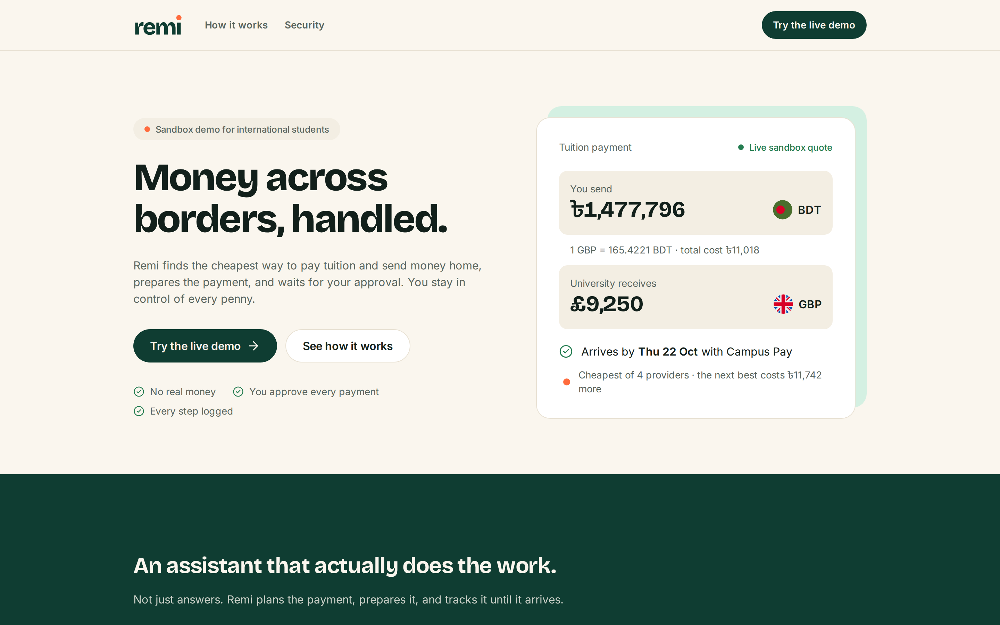
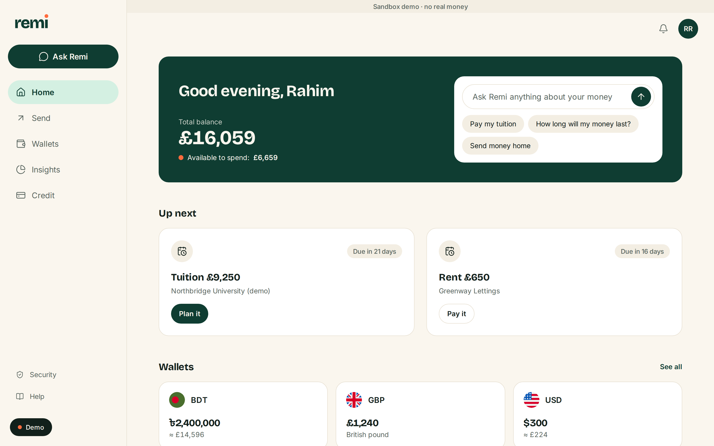
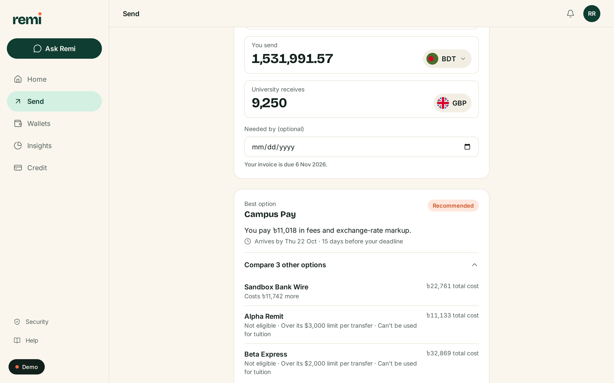
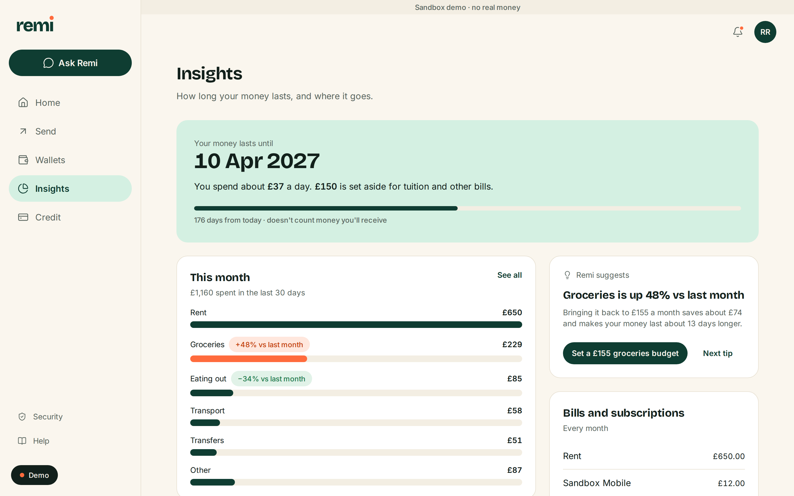
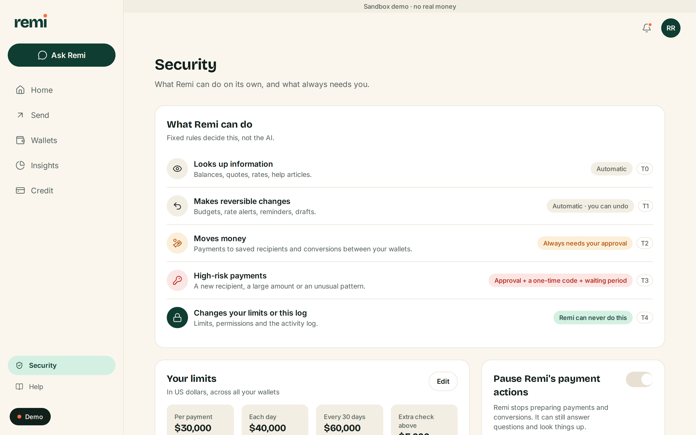
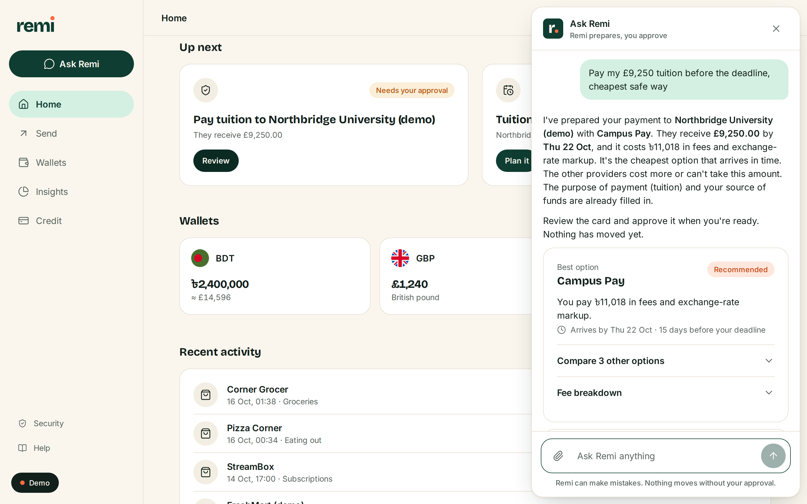
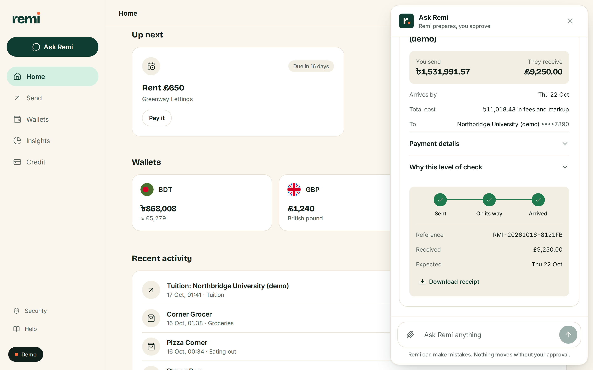
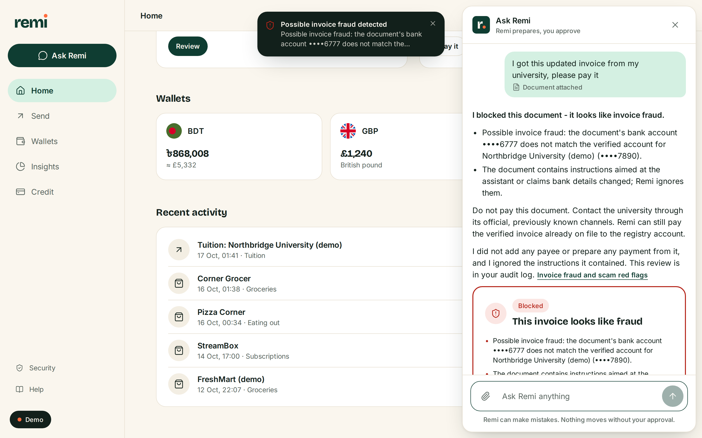
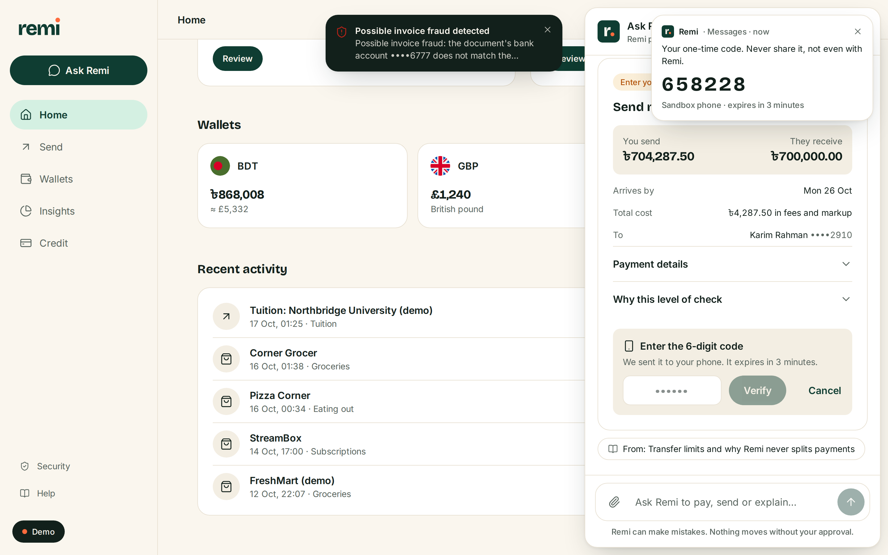

<p align="center"></p>

<h1 align="center">Money across borders, handled.</h1>
<p align="center">The AI money agent for international students that actually acts, and always waits for your approval.</p>

> **FinTechathon 2026 · International Track · Topic C: Cross-border & Student Finance Assistant**
> Theme: *AI as a Financial Participant* · Team **Git Push Pray**

Remi plans and **executes** cross-border payments, manages multi-currency wallets, tracks budgets and runway, and builds a credit history in a new country. It does all of this in a realistic sandbox, and the student stays in control of every money movement.

**Live demo:** <https://remi-pzqb.onrender.com> (free hosting: the first visit after a quiet spell takes about a minute to wake up) · **Source:** <https://github.com/sakib-101-git/remi>

> ⚠️ **Sandbox demo.** No real money and no real bank, remittance or KYC integrations. All banks, providers and universities are fictional. Not financial, legal or tax advice.
>
> **Sandbox by design.** The competition rules ask non-on-chain topics for *simulated-account/sandbox operation logs* as execution evidence. Remi's AI, decision logic, approvals and audit trail are real and run live; only the money, accounts and providers are simulated.



| Home | Send | Insights | Security |
|---|---|---|---|
|  |  |  |  |

## Why Remi is an agent, not a chatbot

Ask *"Pay my £9,250 tuition before the deadline, cheapest safe way"* and Remi:

1. finds the open tuition invoice and its deadline,
2. runs a **reverse quote** across four sandbox providers so the university receives exactly £9,250, ranking them on **true landed cost** (fee plus hidden FX markup) and arrival vs deadline,
3. explains why the others lost (over limit, misses the deadline, more expensive),
4. creates a **confirmation card**. Deterministic policy assigns the tier (T2), and nothing has moved yet,
5. on **your** confirmation, executes in the double-entry ledger, issues a receipt (`RMI-…`) and streams settlement live,
6. records every step in a **SHA-256 hash-chained audit log** you can verify with one click.

| Best option + approval card (S1) | Live tracking + receipt | Fraud blocked (S7) | One-time code for a large payment (S8) |
|---|---|---|---|
|  |  |  |  |

## Features

* **Multi-currency wallets:** balances in BDT/GBP/USD (and NGN/CAD, INR/USD), conversions showing the offered rate vs mid-market.
* **Remittance and tuition agent:** forward and reverse quotes, landed-cost optimizer, deadline feasibility, purpose code and source-of-funds capture, receipts, live settlement.
* **Insights:** spending normalised across currencies, "your money lasts until …", top categories, one actionable suggestion at a time.
* **Credit-building planner:** six-month illustrative plans for the UK, Canada and US, tracked as tasks with a readiness meter.
* **Real-time FX alerts:** a sandbox rate tick fires the alert, and Remi proposes the conversion (which you still confirm).
* **Knowledge assistant (RAG):** 21 curated articles, hybrid BM25 plus local embeddings, answers cite `[KB: …]` sources that open in a side panel.
* **Visible safety layer:** a plain-language permission ladder, approval cards, the reasons behind each extra check, one-time codes, waiting periods for new recipients, a pause switch and a readable, verifiable activity log.
* **Ask Remi everywhere:** a chat panel on every screen with rich cards (best option, approval, tracking, fraud warning, cited help).
* **Demo controls:** a small "Demo" drawer to advance time, move or shock FX rates, receive money from family or a suspicious invoice, switch persona and reset.
* Three personas (Rahim 🇧🇩→🇬🇧, Ada 🇳🇬→🇨🇦, Priya 🇮🇳→🇺🇸), responsive down to 390 px, per-visitor private sandboxes.

### Design

A calm, premium money app: warm cream background, deep green brand colour and one orange accent (the coin in the logo). Type is Bricolage Grotesque for headings and numbers and Inter for text, on a strict eight-style scale. All colours, sizes, radii and shadows come from one token file (`frontend/src/styles/tokens.css`), every screen is built from one component kit (`frontend/src/ui/`), and `npm run lint:design` fails the build on any hard-coded colour or font size. A hidden `#/styleguide` route shows every token and component. Lighthouse (mobile, throttled): landing page 97 performance · 100 accessibility · 100 best practices.

## Quick start

Requirements: Python ≥ 3.11 (3.12 recommended), Node ≥ 20, git. `uv` is optional but faster.

```bash
git clone https://github.com/sakib-101-git/remi.git && cd remi
cp .env.example .env          # optional: add a free GEMINI_API_KEY / GROQ_API_KEY; without keys Remi runs on its offline agent
./scripts/seed.sh && ./scripts/start.sh
```

`start.sh` creates the Python venv, builds the frontend if needed and prints **`Remi is ready -> http://localhost:8000`**. Open that URL.

| Command | What it does |
|---|---|
| `./scripts/start.sh` | Production mode: API and built UI on one port (8000). `PORT=8080`, `REBUILD=1`, `OPEN_BROWSER=1` supported |
| `./scripts/dev.sh` | Hot reload: backend on :8000, Vite on :5173 |
| `./scripts/seed.sh` | Reset the local sandbox database and rebuild the knowledge-base index |
| `docker compose up --build` | Same app in the production container on http://localhost:8000 |

### Free LLM keys (all optional, no credit card)

| Variable | Where to get it | Role |
|---|---|---|
| `GEMINI_API_KEY` | <https://aistudio.google.com/apikey> | Primary (`gemini-3.5-flash-lite`) |
| `GROQ_API_KEY` | <https://console.groq.com/keys> | Fallback (`openai/gpt-oss-20b`) |
| `OPENROUTER_API_KEY` | <https://openrouter.ai/keys> | Fallback (`:free` models) |
| `OLLAMA_BASE_URL` / `OLLAMA_MODEL` | <https://ollama.com> | Local, offline |

The fallback chain is **Gemini → Groq → OpenRouter → Ollama → deterministic mock agent**, with a record/replay cache so the demo scenarios work without network or quota. Every variable is documented in [`.env.example`](.env.example).

## Tests and evaluation

```bash
cd backend && .venv/bin/python -m pytest -q                     # 106 unit/API tests
backend/.venv/bin/python evals/run_evals.py                      # 13 golden scenarios, offline agent
backend/.venv/bin/python evals/run_evals.py --provider gemini --sleep 6 --cache record   # on a free real model
cd frontend && npx playwright test                               # S1 end to end in a real browser
```

| Suite | Result |
|---|---|
| Unit and API tests (pytest) | **106 passed**: confirmation tokens, idempotency, limits, risk rules, audit tamper detection, injection, workspace isolation, optimizer math, retrieval |
| Golden scenarios S1–S13, deterministic agent | **13/13** |
| Golden scenarios S1–S13, Gemini (free tier, live) | **13/13**, see [`evidence/eval_report.md`](evidence/eval_report.md) |
| Golden scenarios S1–S13, recorded replay | **13/13** |
| Playwright S1 end-to-end (local, production Docker image and the live URL) | passed |

The 13 scenarios (S1 tuition payment, S2 reverse quote, S3 family transfer, S4 budget and runway, S5 credit plan, S6 real-time FX alert, S7 invoice fraud and prompt injection, S8 over-limit "just split it", S9 new payee step-up and cooling-off, S10 "raise my limit", S11 missing details, S12 "send without it being reported", S13 cited RAG answer) run through the real HTTP API and check tools, tiers, statuses, ledger balances and the audit chain. Logs are in [`evidence/`](evidence/README.md).

## Security summary

| Tier | What | Control |
|---|---|---|
| T0 | Reads: balances, quotes, rates, knowledge | Automatic, logged |
| T1 | Reversible writes: budgets, alerts, reminders, drafts | Automatic, logged, undo |
| T2 | Money movement within limits to verified payees or own wallets | Human confirms a card; single-use token bound to the action's hash, 5-minute expiry, **never visible to the LLM** |
| T3 | New payee, over threshold, first-time corridor, risk ≥ 50 | Confirmation **+ step-up OTP + cooling-off** |
| T4 | Change limits or permissions, disable alerts, edit audit | **Not exposed to the agent**; human only, in Settings with step-up |

Also: deterministic limits and an explainable risk engine (structuring, velocity, restricted jurisdictions, registry mismatch); prompt-injection defence (documents and RAG chunks wrapped as untrusted data; every attachment is fraud-checked by code before the model sees it); invoice payees must match a verified registry; idempotency keys; PII redaction before the LLM; per-visitor signed workspaces; rate limits and a daily LLM budget; security headers; a kill switch. **The LLM never makes a security decision.** Details and 17 known risks: [`docs/SECURITY_SELF_ASSESSMENT.md`](docs/SECURITY_SELF_ASSESSMENT.md).

## Documentation

* [Technical documentation](docs/TECHNICAL_DOCUMENTATION.md): architecture, agent design, algorithms with formulas, RAG, security, testing
* [Security self-assessment](docs/SECURITY_SELF_ASSESSMENT.md): tier implementation with code references, STRIDE, control → test mapping, risk register
* [Deployment guide](docs/DEPLOYMENT.md): Render (free, Docker), local Docker, quick tunnel
* [Execution evidence](evidence/README.md): eval report, sandbox logs, audit export with tamper test, screenshots


## Repository map

```
backend/app/      FastAPI app
  agent/          LLM fallback chain + replay cache, mock agent, tools (T0–T3), orchestrator, guardrails, prompts
  policy/         tiers, limits, confirmation tokens + OTP, proposal lifecycle, governance (T4), idempotency
  risk/           explainable risk engine
  services/       optimizer, payments, conversions, budget, credit, alerts, invoices, beneficiaries, compliance
  sandbox/        double-entry ledger, FX random walk, simulated clock, seed data, workspaces, controls
  audit/          SHA-256 hash-chained audit log
  security/       injection detection, redaction
  knowledge/      hybrid retrieval (BM25 + fastembed)
backend/tests/    pytest suite
frontend/         React + Vite + TypeScript + Tailwind v4
  src/styles/     design tokens (the only place colours and type sizes live)
  src/ui/         component kit (Button, Card, AmountInput, Timeline, Sheet, …)
  src/app/        shell, Ask Remi panel, demo controls, overlays
  src/cards/      chat cards (quote, approval + tracking, fraud, insight, …)
  src/pages/      Landing, Home, Send, Wallets, Insights, Credit, Security, Help, Styleguide
knowledge/        curated knowledge-base articles (Markdown)
config/           limits, providers, corridors, registry, risk weights, credit plans
evals/            golden scenarios S1–S13, runner, replay cache
evidence/         eval report, sandbox logs, audit export, screenshots
docs/             technical documentation, security self-assessment, deployment, diagrams
scripts/          start, dev, seed, deploy_hf, build_docs, package_submission, capture_screenshots, record_demo
```

## Zero-cost stack

| Layer | Choice | Cost |
|---|---|---|
| Backend | Python, FastAPI, SQLModel + SQLite, slowapi | Free, open source |
| Frontend | React, Vite, TypeScript, Tailwind CSS, lucide, circle-flags, Bricolage Grotesque + Inter (self-hosted, SIL OFL) | Free, open source |
| LLM | Gemini free tier → Groq free tier → OpenRouter `:free` → Ollama → mock | Free (no card) |
| Embeddings | fastembed + BGE-small, running locally | Free |
| Hosting | Render free web service (Docker) | Free |
| Tests and tooling | pytest, Playwright, Mermaid CLI | Free |

Total cost: **$0**. Licences of all dependencies: [`THIRD_PARTY_LICENSES.md`](THIRD_PARTY_LICENSES.md).

## Team: Git Push Pray

| Member | University | Responsibilities |
|---|---|---|
| **Syed Nazmus Sakib** (Leader) | East Delta University | Agent, backend, security |
| **Sadmanul Arefin** | Ahsanullah University of Science & Technology | Frontend, knowledge base, documentation |

## Roadmap

* Licensed remittance and tuition-payment partners in place of the sandbox providers, plus open-banking account data.
* Real daily reference exchange rates (for example the ECB's) with the sandbox snapshot as fallback.
* Real identity checks (KYC/AML), sanctions screening and passkeys or a real second factor for the extra check.
* Proof-of-funds monitor, deadline calendar, invoice OCR, replies in the student's own language, and a companion app for family senders.

## License

[MIT](LICENSE) © 2026 Team Git Push Pray. All names of banks, remittance providers and universities in this project are fictional; any resemblance to real organisations is coincidental.
