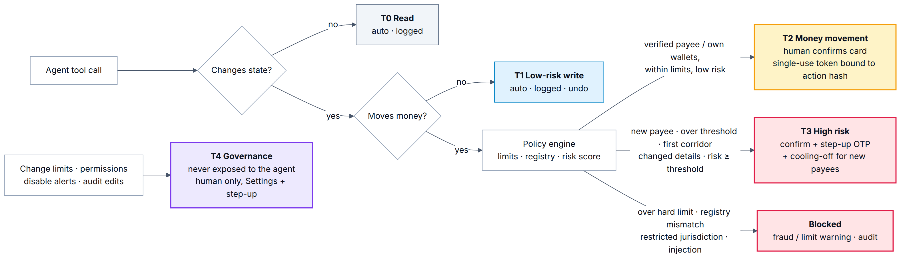

# 1. Scope and method

This report covers the Remi sandbox application in this repository: the FastAPI backend, the React frontend, the agent and its free LLM providers, the knowledge base and the public demo deployment. Remi moves **only sandbox money**. It has no real bank, remittance, KYC or card integrations, and all names of banks, remitters and universities are fictional.

We assessed it in three ways:

1. **Design review** of each control against the permission-tier model in §2. Every row cites the file and function that enforces it.
2. **STRIDE-lite threat modelling** of the trust boundaries: browser ↔ API, API ↔ agent, agent ↔ LLM provider, documents and knowledge base ↔ agent, and operator ↔ public deployment.
3. **Automated evidence:** 106 pytest unit/API tests, a Playwright end-to-end test of S1 and 13 golden scenarios (S1–S13). The scenarios run through the real HTTP API on the deterministic agent and on a free real model (Gemini). Results are in `evidence/eval_report.md`.

The core principle: **the LLM never makes a security decision.** It interprets intent, picks tools and explains results. Deterministic code computes every amount, assigns every tier and approves or blocks every action. Only a human, holding a token the model never sees, can release money.

# 2. Permission-tier implementation

| Tier | Meaning | Examples | Control | Enforced in |
|---|---|---|---|---|
| **T0** Read | No state change | `get_wallets`, `get_remittance_quotes`, `reverse_quote`, `get_budget_summary`, `search_knowledge` | Automatic, logged | `agent/tools.py` · `TOOLS` registry (tier tag) and `run_tool()` (audit `tool.called`) |
| **T1** Low-risk write | Reversible, no money movement | `set_rate_alert`, `create_budget`, `create_reminder`, `update_credit_task`, `draft_payment` | Automatic, logged, undo available | `agent/tools.py` · `run_tool()`; services in `services/alerts.py`, `services/budget.py`, `services/credit.py` |
| **T2** Money movement | Within limits, verified payee or own wallets | `propose_payment`, `propose_fx_conversion` | Explicit human confirmation of a card showing amount, rate, fees, landed cost, recipient and arrival. Single-use token bound to the action hash, 5-minute expiry, never shown to the LLM | `policy/actions.py` · `propose()`, `confirm()`; `policy/tokens.py` · `issue_token()`, `token_matches()`, `payload_hash()` |
| **T3** High risk | New payee, over threshold, first-time corridor, changed details, risk ≥ 50 | `propose_add_beneficiary`; a T2 action escalated by policy | Confirmation **+ step-up OTP** (phone-style notification, 3 attempts, 3-minute expiry) **+ cooling-off** for new payees | `policy/engine.py` · `evaluate_payment()`, `evaluate_new_beneficiary()`, `Decision.escalate()`; `policy/actions.py` · `step_up()`, `_add_beneficiary()`, `run_scheduled()`; `policy/tokens.py` · `issue_otp()`, `otp_matches()` |
| **T4** Governance | Change limits, permissions, alerts, audit | "Raise my daily limit to 1,000,000" | **Not exposed as a tool.** Refused before any LLM call; human-only via the Security page with step-up | `agent/guardrails.py` · `precheck()`; `policy/governance.py` · `request_limit_change()`, `verify_limit_change()`, `set_kill_switch()` |

**Tier assignment is deterministic.** The LLM can call only `policy.actions.propose()`. The tier comes from `policy/engine.py`:

* Per-transaction maximum $30,000, daily maximum $40,000 and 30-day maximum $60,000 (USD equivalent) → **blocked** (`_common_limits()`).
* Above $5,000 for ordinary payees, or $20,000 for registry-verified institutions, or crossing the $15,000 daily soft limit → **T3** (`evaluate_payment()`).
* Risk score ≥ 50 → **T3**; ≥ 80, or any hard-block rule (registry mismatch, restricted jurisdiction, injection in the source document) → **blocked** (`_apply_risk()`).
* New beneficiary → **always T3** with cooling-off (`evaluate_new_beneficiary()`).
* Kill switch on → every agent money proposal is **blocked**.

**Layering is enforced by reachability.** No agent tool can reach `confirm()`, `step_up()` or `_execute()`. They are called only from the human-facing routes `POST /api/actions/{id}/confirm` and `/stepup` in `api/routes.py`. Those routes require an `Idempotency-Key` (`policy/idempotency.py`) and re-run the full policy evaluation against live state before executing.

# 3. Control catalogue

| # | Control | Implementation (file · function) |
|---|---|---|
| C1 | Confirmation tokens: 256-bit random secret. The server stores only `HMAC(secret, token‖action_id‖payload_hash)`. Single use, 5-minute TTL; re-issuing invalidates the old token | `policy/tokens.py` · `issue_token()`, `token_matches()`; `policy/actions.py` · `confirm()`, `reissue_token()` |
| C2 | Token never visible to the LLM: tool output for the agent is built by `for_agent()`, and only UI cards carry the token. Chat history and notifications strip tokens | `policy/actions.py` · `for_agent()`, `public()`; `agent/orchestrator.py` · `_cards_for_storage()` |
| C3 | Payload binding: any change to amount, payee, rate or provider changes the SHA-256 payload hash and invalidates the token | `policy/tokens.py` · `payload_hash()`; `policy/actions.py` · `confirm()` |
| C4 | Policy re-evaluation at execution time (balance, limits and risk may have changed since the proposal) | `policy/actions.py` · `confirm()` → `_evaluate()` |
| C5 | Step-up OTP via a separate channel (`sandbox_phone` SSE event), HMAC-stored, 3 attempts then cancel | `policy/actions.py` · `step_up()`; `policy/tokens.py` · `issue_otp()` |
| C6 | Cooling-off for new payees: the payment becomes `scheduled` and is released only after the period ends | `policy/actions.py` · `_add_beneficiary()`, `run_scheduled()`; `services/beneficiaries.py` · `is_active()` |
| C7 | Limits and velocity (per transaction, daily, 30-day, per hour/day count) from `config/limits.yaml` | `policy/engine.py` · `_common_limits()`; `policy/limits.py` · `effective_limits()`, `usage()` |
| C8 | Explainable risk engine (0–100, weighted rules with reasons): amount vs history, velocity, new payee, first-time corridor, structuring, registry mismatch, restricted jurisdiction, unusual hour, injection source | `risk/engine.py` · `assess_payment()`, `assess_new_beneficiary()`, `assess_conversion()` |
| C9 | Anti-structuring: the optimizer never splits a payment; it reroutes to a channel that supports the amount. Structuring patterns raise the risk score | `services/quotes.py` · `compare()`; `services/payments.py` · `plan()`; `risk/engine.py` · `_recent_payments_usd()` |
| C10 | Prompt-injection defence: documents, tool outputs and RAG chunks are scanned and wrapped as untrusted data with neutralised delimiters | `security/injection.py` · `scan()`, `wrap_untrusted()`; `knowledge/retrieval.py` |
| C11 | Invoice-fraud defence: **every attachment is reviewed by deterministic code before the model sees it** (the model cannot skip the check). If fraud is suspected, the money-moving tools are removed for that turn. Payee details always come from the verified registry, never from document text, and a registry mismatch is a hard block | `agent/orchestrator.py` · `run_turn()` (document pre-review); `services/invoices.py` · `analyze()`, `draft_from_invoice()`; `services/beneficiaries.py` · `registry_check()` |
| C12 | Tool allowlist per detected intent, Pydantic schema validation of every call, ≤ 8 tool calls per turn | `agent/orchestrator.py` · `classify_groups()`, `run_turn()`; `agent/tools.py` · `schemas_for()`, `run_tool()` |
| C13 | Deterministic guardrails before any LLM call (evasion, T4 governance, off-topic); output validation removes false "done" claims | `agent/guardrails.py` · `precheck()`, `validate_output()` |
| C14 | Append-only SHA-256 hash-chained audit log, verify and export endpoints | `audit/log.py` · `append()`, `verify()`, `export()` |
| C15 | Privacy: masked account numbers, PII/secret redaction in tool output, chat history and audit inputs | `security/redact.py` · `mask_account()`, `redact()`, `redact_text()` |
| C16 | Per-visitor isolation: `itsdangerous`-signed workspace cookie; every row is scoped by `workspace_id`. Forged cookies get a fresh workspace | `api/deps.py` · `sign()`, `unsign()`, `uow()`; `models/tables.py` |
| C17 | Idempotency keys on all execute endpoints; the same key with a different body is rejected | `policy/idempotency.py` · `lookup()`, `store()` |
| C18 | Public-deployment protection: per-IP/workspace rate limits, a daily LLM-call budget with fallback to replay/mock ("demo mode" badge), idle-workspace cleanup | `api/limiter.py`; `agent/orchestrator.py` · `_Budget`; `sandbox/workspaces.py` · `cleanup_idle()` |
| C19 | Security headers: CSP, `X-Frame-Options`, `nosniff`, `Referrer-Policy`, `Permissions-Policy`; HttpOnly SameSite=Lax cookie, `Secure` in production | `main.py` · `security_headers()`; `api/deps.py` · `uow()` |
| C20 | Exact money: `Decimal` everywhere, stored as TEXT, ROUND_HALF_UP to minor units; reverse quotes round up so the target is never short | `money.py`; `models/tables.py` (`DecimalText`) |
| C21 | Double-entry ledger: unbalanced postings rejected; the trial balance is zero in every currency | `sandbox/ledger.py` · `post()`, `trial_balance()` |
| C22 | Kill switch: one click pauses all agent T2/T3 proposals | `policy/governance.py` · `set_kill_switch()`; `policy/engine.py` |

# 4. Threat model (STRIDE-lite)

| Threat | Example against Remi | Mitigations | Residual |
|---|---|---|---|
| **S**poofing | Forge another visitor's workspace cookie; replay a confirmation token; guess an OTP | Signed cookies (C16); HMAC-bound single-use tokens (C1, C3); OTP with 3 attempts and 3-minute TTL (C5) | Low. The sandbox has no real user authentication (by design) |
| **T**ampering | Change amount or payee between proposal and confirm; edit audit rows; tamper with the request body under the same idempotency key | Payload-hash binding (C3); policy re-evaluation (C4); hash chain (C14); idempotency body hash (C17) | Low. An attacker with DB write access could rebuild the whole chain (see R13) |
| **R**epudiation | "I never approved that payment" | Every proposal, confirmation, step-up and execution is in the hash-chained audit log with actor and tier (C14) | Low within the sandbox |
| **I**nformation disclosure | Prompt-inject the model into revealing tokens; leak PII to the LLM provider; cross-workspace reads | The token never enters LLM context (C2); redaction (C15); workspace scoping (C16); fake sandbox data only | Medium: free-tier providers may log prompts (R4) |
| **D**enial of service | Flood chat to burn the free LLM quota; create thousands of workspaces | Rate limits, daily LLM budget with replay/mock fallback, idle cleanup (C18) | Medium: the free host can still be saturated (R5) |
| **E**levation of privilege | Ask the agent to raise limits, disable alerts, add a payee from an invoice, or split payments to dodge limits | T4 not exposed (C13); new payee always T3 (C6); registry check (C11); anti-structuring (C9); tool allowlist (C12) | Low. Covered by S7, S8, S9, S10 and S12 |

# 5. Control → test mapping

| Control | Automated tests (backend/tests) | Golden scenario |
|---|---|---|
| C1 single-use / expiry / wrong token | `test_confirmation.py`: `test_token_is_single_use`, `test_wrong_token_rejected`, `test_token_from_other_action_rejected`, `test_expired_token_rejected`, `test_reissue_invalidates_old_token` | S1, S3 |
| C2 token never reaches the LLM | `test_api.py::test_chat_streams_card_but_llm_never_sees_token`; `test_agent.py::test_tool_data_for_llm_has_no_token_and_masked_accounts` | all |
| C3 payload binding | `test_confirmation.py::test_tampered_payload_rejected`, `test_token_hash_bound_to_payload` | — |
| C5 step-up | `test_confirmation.py::test_step_up_required_and_wrong_otp_counts_attempts`, `test_step_up_with_correct_otp_executes` | S8, S9 |
| C6 cooling-off | `test_confirmation.py::test_new_beneficiary_cooling_off_then_release`; `test_policy.py::test_new_beneficiary_is_always_t3` | S9 |
| C7 limits | `test_policy.py::test_per_transaction_max_blocks`, `test_daily_soft_limit_escalates`, `test_large_payment_requires_step_up`, `test_insufficient_funds_blocks` | S8 |
| C8 risk engine | `test_risk.py` (5 tests incl. `test_structuring_pattern_detected`, `test_score_is_capped_and_explained`) | S8, S9 |
| C9 anti-structuring | `test_policy.py::test_requested_low_limit_provider_is_rerouted_not_split`; `test_agent.py::test_s8_refuses_split_and_reroutes` | S8 |
| C10/C11 injection and fraud | `test_injection.py` (7 tests); `test_policy.py::test_registry_mismatch_is_blocked_as_fraud`; `test_agent.py::test_s7_injection_in_document_creates_no_action`, `test_poisoned_kb_chunk_is_sanitised_and_ignored`, `test_attachment_is_reviewed_deterministically_and_fraud_removes_money_tools`, `test_foreign_or_stale_invoice_id_is_replaced_by_own_open_invoice` | S7 |
| C12 tool allowlist / schema / cap | `test_agent.py::test_unknown_tool_is_rejected`, `test_tool_outside_intent_allowlist_rejected`, `test_invalid_tool_arguments_rejected`, `test_max_tool_calls_cap` | — |
| C13 guardrails / output validation | `test_agent.py::test_s12_evasion_refused`, `test_output_validation_blocks_false_done_claims`; `test_api.py::test_governance_request_is_refused_by_agent` | S10, S12 |
| C14 audit chain | `test_audit.py::test_chain_verifies_after_activity`, `test_tampered_content_detected`, `test_deleted_entry_detected`, `test_rehashed_entry_breaks_next_link`; `test_api.py::test_audit_verify_and_export` | all (final `audit_valid` check) |
| C15 redaction | `test_audit.py::test_secrets_and_accounts_redacted_in_audit` | — |
| C16 isolation | `test_api.py::test_workspaces_are_isolated`, `test_forged_cookie_gets_fresh_workspace`, `test_session_sets_signed_cookie` | — |
| C17 idempotency | `test_api.py::test_double_submit_with_same_idempotency_key_pays_once`, `test_new_key_cannot_replay_used_token`, `test_idempotency_key_required` | S1 |
| C20/C21 money and ledger | `test_money.py` (5), `test_ledger.py` (4), `test_quotes.py` | S1, S2 (exact reverse quote) |
| C22 kill switch / T4 | `test_policy.py::test_kill_switch_blocks_agent_proposals`; `test_api.py::test_kill_switch_blocks_agent_payments`, `test_limit_change_requires_step_up` | S10 |

# 6. Known-risk register

Likelihood and impact are rated for the **public sandbox demo**; the last column says what a production system would add.

| # | Risk | Likelihood | Impact | Mitigation in Remi | Residual / production path |
|---|---|---|---|---|---|
| R1 | **LLM writes a wrong or hallucinated explanation** (e.g. cites the wrong article or misstates which wallet is used) | Medium | Medium | Numbers come only from tools; output validation blocks false "done" claims; cards show the authoritative figures; citations link to the actual article | Medium. Text can still be misleading even when the cards are correct. Production: claim-checking of numbers in text against tool output |
| R2 | **Mock vs real-model gap**: tests run on the deterministic agent; free models are weaker | Medium | Medium | The eval harness runs S1–S13 on a real free model and fails any turn that silently fell back to mock | Medium. Model behaviour drifts between versions; re-run evals on every model change |
| R3 | **Free-tier rate limits and outages** (429/503, slow responses) | High | Medium | Fallback chain Gemini → Groq → OpenRouter → Ollama → mock; record/replay cache for demo scenarios; daily budget with a visible "demo mode" badge | Low for the demo; production needs a paid SLA or self-hosted model |
| R4 | **Free-tier providers may log or train on prompts** | High | Low (sandbox) | Fictional sandbox data only; PII and account redaction before the LLM; tokens never sent | Production: no-retention enterprise tier or self-hosted model |
| R5 | **Public demo abuse** (spam, quota burning, scripted workspace creation) | Medium | Medium | Per-IP and per-workspace rate limits; daily LLM budget; idle-workspace cleanup; no real money | Medium. A determined attacker can still exhaust the free host; production adds auth, CAPTCHA and a WAF |
| R6 | **Ephemeral free-hosting storage**: restarts wipe the SQLite DB | High | Low | Per-visitor workspaces re-seed automatically; the replay cache is baked into the image | Production: managed Postgres with backups |
| R7 | **SQLite is not production-grade** (single writer, no HA) | High | Low (demo) | WAL mode; short transactions; one transaction per request | Production: Postgres, row-level locking for balances |
| R8 | **Simulated OTP**: the code is shown in an in-app phone-style notification | Certain | Low (sandbox) | Separate SSE channel, HMAC storage, attempt limit and expiry model the real flow | Production: real second factor (TOTP, passkeys, SMS via a provider) |
| R9 | **Illustrative compliance rules** (purpose codes, document checklists, credit steps, restricted list with fictional codes) | Certain | Medium | Clearly labelled "illustrative, verify with official sources"; disclaimer on every page | Production: rules maintained by compliance staff per corridor and licence |
| R10 | **No real KYC/AML screening** | Certain | High (if real) | Simulated KYC status; risk rules for structuring, velocity and restricted jurisdictions | Production: licensed KYC/sanctions screening provider and transaction monitoring |
| R11 | **RAG content may become outdated** | Medium | Medium | `last_reviewed` front-matter on every article; minimum-score threshold so the agent says "I don't know" | Production: content ownership and review cadence |
| R12 | **Prompt injection via novel phrasing** not caught by the pattern scanner | Medium | Low | Defence in depth: even an uncaught injection cannot add payees, change bank details (registry only) or move money without a human token | Low. The scanner is a signal, not the gate |
| R13 | **Audit chain rewritten by someone with DB write access** | Low | Medium | Chain verification detects edits, deletions and single-row rehashes | Production: anchor periodic chain heads externally (WORM storage or a timestamping service) |
| R14 | **Secret key management**: `SECRET_KEY` in an env var signs cookies and HMACs | Low | High | Production never uses the public dev default: without `SECRET_KEY` it generates a random per-process key (`config.py` · `_secret_key()`). Secrets come from platform secret settings and are never committed (`.env` gitignored) | Production: KMS/HSM-backed keys with rotation |
| R15 | **No user authentication**: anyone with the cookie controls that workspace | Certain | Low (sandbox) | Workspaces hold only fake data; signed cookie; HttpOnly, SameSite=Lax, Secure in production | Production: real accounts, MFA, session management |
| R16 | **Deterministic FX random walk** is not real market data | Certain | Low | Labelled "sandbox rates" with timestamps; no price prediction or speculation advice (guardrail) | Production: licensed rate feeds |
| R17 | **Supply-chain risk** in npm/PyPI dependencies | Low | Medium | Pinned Python versions, `package-lock.json`, permissive licences reviewed (`THIRD_PARTY_LICENSES.md`) | Production: Dependabot/SCA scanning, signed images |

# 7. Out of scope

* Real money movement, real bank/remittance/card APIs and open-banking connections.
* Real identity verification, sanctions screening and regulatory reporting.
* Legal, tax or investment advice. Remi refuses these and gives general information with a disclaimer.
* Multi-tenant production hardening: SSO, encryption at rest, HSM key custody, SOC 2 controls.
* Mobile apps and offline clients.

# 8. Conclusion

Remi's security model does not depend on the LLM behaving well. A model that is wrong, prompt-injected or replaced by the deterministic mock **cannot move money**, because a human must present a server-issued, payload-bound, single-use token that never enters the model's context. Every decision is deterministic, explainable and recorded in a verifiable audit chain. The remaining risks come mainly from the zero-cost sandbox setting (free providers, simulated OTP, illustrative compliance). Each has a clear production replacement.

*Sandbox demo. Not financial, legal or tax advice.*
