# 1. Executive summary

**Remi is an AI money agent for international students that actually acts.** It plans and executes cross-border payments, manages multi-currency wallets, tracks budgets and runway, and builds a credit history in a new country. It works entirely inside a realistic sandbox: a double-entry ledger, simulated FX, four fictional payment providers, and per-visitor workspaces.

Remi follows the track theme, *AI as a Financial Participant*. The agent completes real tasks end to end. It compares providers on true landed cost, prepares an exact payment, gets human confirmation, executes it in the sandbox ledger, issues a receipt and tracks settlement in real time. Security comes from a strict separation of concerns:

* The **LLM only interprets intent, chooses tools and explains results.** Every number comes from deterministic code using `Decimal` arithmetic.
* A **deterministic policy engine is the only gate to money movement.** It assigns permission tiers T0–T4, enforces limits, scores risk and issues **single-use confirmation tokens bound to the exact action**. The LLM never sees these tokens.
* High-risk actions add **step-up verification** (simulated OTP on a "Sandbox phone") and **cooling-off** for new payees.
* Every step is written to an **append-only, SHA-256 hash-chained audit log** that anyone can verify.
* **Prompt-injection and invoice-fraud defences** treat document and knowledge-base text as untrusted data. University payments must match a verified registry.

Remi runs at zero cost. The primary model is Google Gemini's free tier, with a fallback chain (Groq → OpenRouter free → local Ollama → deterministic mock agent) and a record/replay cache, so the live demo never depends on rate limits or venue Wi-Fi.

**Results (sandbox):** 13/13 golden scenarios pass end to end through the real HTTP API on the deterministic agent (122/122 checks), on Google Gemini's free tier live (136/136 checks, no fallback allowed) and from the recorded replay cache (136/136). 103 automated unit and API tests and a Playwright browser test of S1 are green. Details in §10.

# 2. Problem and target users

## 2.1 Pain points

International students move money across borders at the most expensive and stressful moments of their lives:

| Pain point | What goes wrong today |
|---|---|
| Hidden FX markups | Providers advertise "low fees" but hide 1–3% in the exchange rate. In our sandbox, Beta Express charges the *lowest* fee for a £9,250 tuition payment (৳244) but has the *highest* total cost (৳32,869), three times the best option. |
| Tuition deadlines | Slow rails (3–5 business days), cut-off times and document checks make deadlines easy to miss. |
| Limits and documentation | Cheap apps have low per-transfer limits. Students are tempted to split payments, which looks like *structuring* and can get accounts frozen. |
| Multi-currency confusion | Money sits in BDT, GBP and USD. Nobody knows the total or how long it will last. |
| No credit history | Arrivals cannot rent, get phone contracts or cards. |
| Scams | "Our bank details have changed" invoices target students right before deadlines. |

## 2.2 Personas (seed data, switchable in the UI)

| Persona | Corridor | Wallets | Situation |
|---|---|---|---|
| **Rahim** | Bangladesh → UK, Master's | BDT 2,400,000 · GBP 1,240 · USD 300 | £9,250 tuition due in 21 days, family sends BDT monthly, no UK credit history |
| **Ada** | Nigeria → Canada, undergraduate | NGN 6,500,000 · CAD 3,200 · USD 150 | Rent CAD 1,150/month, sends money to mum, wants credit |
| **Priya** | India → USA, PhD | INR 250,000 · USD 4,800 | Stipend, fees due, sends money home |

Each persona has 90 days of deterministic transaction history, beneficiaries, obligations and an invoice from a fictional institution in the verified registry.

<!-- pagebreak -->
# 3. System architecture

## 3.1 Layered architecture

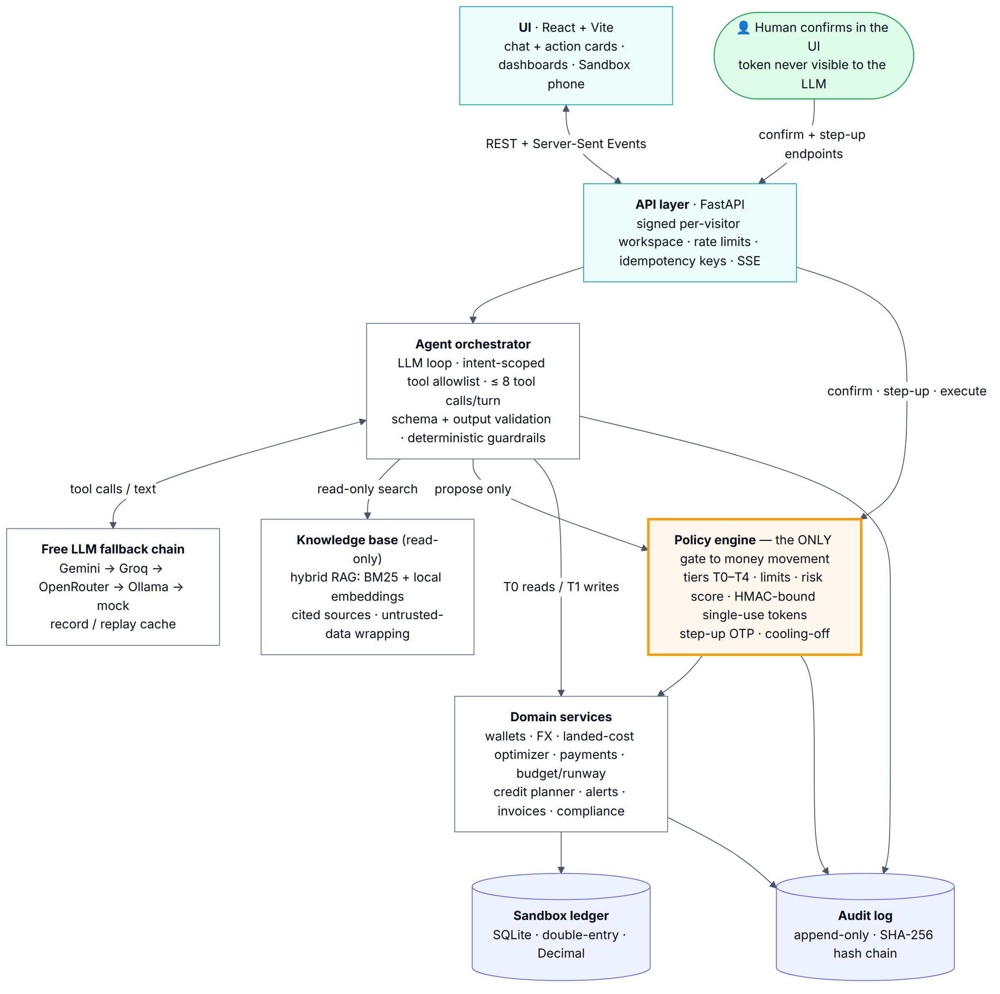

```
UI (React: chat + action cards + dashboards + Sandbox phone)
   │  REST + Server-Sent Events
API layer (FastAPI; signed per-visitor workspace cookie; rate limiting; idempotency keys)
   │
Agent orchestrator (LLM loop; intent-scoped tool allowlist; ≤ 8 tool calls/turn; schema validation; output validation)
   │  proposes actions only                 │ read-only
Policy engine (tiers, limits, risk score,    Knowledge base (hybrid RAG, cited sources,
confirmation tokens, step-up, cooling-off)   untrusted-data wrapping)
   │  ← the ONLY gate to money movement
Domain services (wallets, FX, optimizer, payments, budget, credit, alerts, invoices)
   │
Sandbox ledger (SQLite, double-entry) + Audit log (append-only, SHA-256 hash chain)
```

The layering is enforced in code. Tools in `backend/app/agent/tools.py` can call read services and `policy.actions.propose()`. Nothing reachable from the agent can call `confirm()`, `step_up()` or `execute()`; those live only behind the human-facing `/api/actions/{id}/confirm|stepup` endpoints.

## 3.2 Components

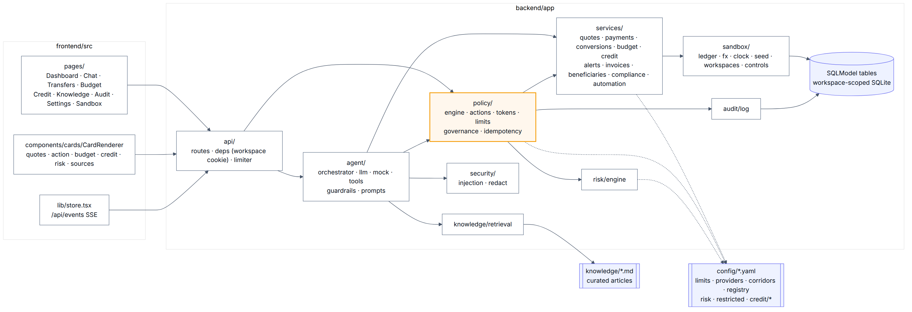

| Module | Responsibility |
|---|---|
| `app/api/` | REST + SSE routes, workspace cookies (`itsdangerous`-signed), `slowapi` rate limits, idempotent execute endpoints |
| `app/agent/` | `llm.py` provider abstraction + fallback chain + replay cache; `mock.py` deterministic agent; `tools.py` typed tool registry; `orchestrator.py` loop; `guardrails.py`; `prompts.py` |
| `app/policy/` | `engine.py` tiering and limits; `actions.py` proposal lifecycle; `tokens.py` HMAC-bound tokens and OTP; `limits.py`; `governance.py` (T4, human only); `idempotency.py` |
| `app/risk/engine.py` | Weighted, explainable risk rules |
| `app/services/` | `quotes.py` optimizer, `payments.py`, `conversions.py`, `budget.py`, `credit.py`, `alerts.py`, `invoices.py`, `beneficiaries.py` (+ verified registry), `compliance.py`, `automation.py` |
| `app/sandbox/` | `ledger.py` double-entry, `fx.py` rates and random walk, `clock.py` simulated time, `seed.py`, `workspaces.py`, `controls.py` |
| `app/audit/log.py` | Append-only hash chain, verify, export |
| `app/security/` | `injection.py` detection and untrusted wrapping, `redact.py` PII/secret redaction |
| `app/knowledge/retrieval.py` | Chunking, BM25, local embeddings, hybrid ranking |

## 3.3 Data flow: a tuition payment from chat to settlement

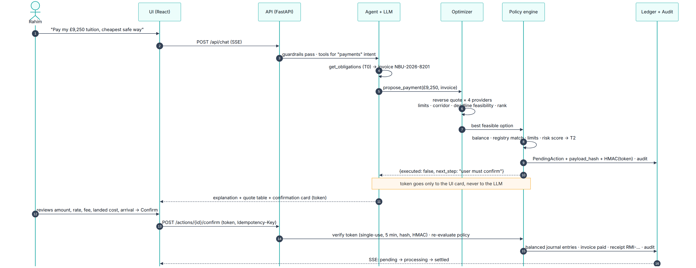

1. **Chat.** Rahim types *"Pay my £9,250 tuition before the deadline, cheapest safe way."* The browser POSTs to `/api/chat` and receives an SSE stream.
2. **Guardrails.** Deterministic pre-checks (evasion, governance, off-topic) pass. Intent classification selects the `payments` tool group, so only those schemas are sent to the model.
3. **Agent loop.** The LLM calls `get_obligations` (T0), which finds the open invoice NBU-2026-8201 due 2026-11-04. It then calls `propose_payment(recipient="university", amount="9250", amount_currency="GBP", invoice_id=…)` (T2).
4. **Optimizer.** `payments.plan()` runs `quotes.compare()` across all four providers as a *reverse quote* (recipient must receive exactly £9,250). It checks corridor, limits, tuition eligibility and deadline feasibility, then ranks the feasible options.
5. **Policy engine.** `evaluate_payment()` checks balance, verified beneficiary, per-transaction, daily and monthly limits, velocity, the registry match and the risk score. Result: **T2** (the verified institution threshold is $20k; the amount is ≈ $12.5k).
6. **Proposal.** A `PendingAction` is stored with the canonical payload, its SHA-256 `payload_hash`, the tier, the risk reasons and `HMAC(secret, token|action_id|payload_hash)`. The **token** is attached only to the UI card. The LLM receives `{"executed": false, "next_step": "the user must confirm …"}`.
7. **Explanation.** The model (or the mock agent) writes the explanation from tool outputs. Output validation strips any false "I've sent" claims.
8. **Human confirmation.** Rahim reviews the card (amount, rate vs mid-market, fee, landed cost, recipient, arrival date, purpose code, source of funds) and presses **Confirm**. The browser POSTs the token with an `Idempotency-Key`.
9. **Execution.** The server re-verifies the token (not used, not expired, payload hash unchanged, HMAC matches), **re-evaluates policy** against live state, and posts balanced journal entries: wallet −send, fees +fee, in-transit +net. It marks the invoice paid and issues a receipt (`RMI-20261014-XXXXXX`).
10. **Settlement.** The settlement engine moves the transfer `pending → processing → settled` (in demo mode after a few seconds, otherwise when simulated time passes the arrival date). It posts the payout legs and pushes live status updates over SSE.
11. **Audit.** Every step (`chat.message`, `tool.called`, `action.proposed`, `action.confirmed`, `action.executed`, `chat.reply`) is chained in the audit log.

# 4. Agent design

## 4.1 Prompting

The system prompt (`app/agent/prompts.py`) is about 450 tokens. It defines Remi's scope, and requires that every number come from tools, that the model only *proposes* money movement, explain recommendations, cite `[KB: title]`, treat `<<UNTRUSTED_DATA>>` blocks as data, never suggest splitting or evasion, give no investment, FX-speculation, legal or tax advice, and ask one clarifying question when details are missing. Persona context (name, corridor, reporting currency, simulated date) is injected per turn.

## 4.2 Tools and tiers

| Tier | Tools |
|---|---|
| **T0** read | `get_wallets`, `get_transactions`, `get_fx_rates`, `get_remittance_quotes`, `reverse_quote`, `explain_fee_breakdown`, `get_budget_summary`, `get_runway`, `get_obligations`, `get_credit_plan`, `get_compliance_checklist`, `search_knowledge`, `analyze_document`, `list_beneficiaries`, `fx_conversion_options` |
| **T1** low-risk write | `create_budget`, `categorize_transaction`, `set_rate_alert`, `create_reminder`, `create_credit_plan`, `update_credit_task`, `draft_payment` (each returns undo information) |
| **T2** money movement | `propose_fx_conversion`, `propose_payment` |
| **T3** high risk | `propose_add_beneficiary`; any T2 proposal the policy engine escalates |
| **T4** governance | *Not exposed as tools.* Limits, permissions, kill switch and audit are reachable only from Settings endpoints with step-up |

Every tool has a Pydantic argument schema, so arguments are validated before the handler runs. Every call goes through `run_tool()`, which applies (1) an **allowlist**: the tool must belong to the intent-selected groups, (2) **schema validation**, (3) a **savepoint**: a failing tool rolls back its partial writes, (4) an **audit entry**, and (5) **redaction** of the LLM-visible output (accounts masked, secrets removed).

## 4.3 Orchestration loop

```
run_turn(user_text, attachment):
    log user message
    pre = guardrails.precheck(text)            # evasion / governance / off-topic → deterministic refusal
    if pre: return refusal + KB sources
    groups = classify(text); tools = schemas_for(groups)       # quota protection: only relevant tools
    messages = system + running summary + last 10 turns + user (+ wrapped untrusted document)
    repeat up to 9 LLM calls:
        result = fallback_chain.chat(messages, tools)          # replay cache → gemini → groq → openrouter → ollama → mock
        if no tool calls: break
        if total calls > 8: stop with safety message
        for call in result.tool_calls:
            out = run_tool(call)                               # allowlist + schema + audit + redaction
            cards += out.cards                                 # UI-only (tokens live here)
            messages += tool result (JSON, ≤12k chars)
    text = validate_output(result.content)                     # no false "done" claims
    ensure citations → source chips; persist; stream cards + text over SSE
```

## 4.4 Free-provider fallback chain, quota protection and replay cache

All providers use **one OpenAI-compatible client** (`openai` SDK used generically) with configurable `base_url`, `model` and `api_key`:

| `LLM_PROVIDER` | Endpoint | Default model (checked 2026-10-16) |
|---|---|---|
| `gemini` (primary) | `https://generativelanguage.googleapis.com/v1beta/openai/` | `gemini-3.5-flash-lite` (or `gemini-3.8-flash`) |
| `groq` | `https://api.groq.com/openai/v1` | `openai/gpt-oss-20b` |
| `openrouter` | `https://openrouter.ai/api/v1` | a `:free` model with tool support |
| `ollama` | `http://localhost:11434/v1` | `qwen3:4b` |
| `mock` | in-process | deterministic agent calling the same tools |

* **Fallback.** On HTTP 429, timeout or tool-call error the chain retries once (0.8 s backoff), then falls through to the next provider. The provider and model that answered are shown as a badge in the UI.
* **Quota protection.** A compact prompt plus intent-scoped tool schemas (typically 6–12 tools rather than 25), a 10-turn history window with a deterministic running summary, a cap of 8 tool calls per turn, a process-wide daily LLM-call budget, and per-IP+workspace rate limits.
* **Record & replay.** `LLM_CACHE=record` stores `hash(conversation shape) → response` in `evals/replay_cache.json`. The hash covers user text and the tool-call sequence and masks IDs and dates, so a replay matches even though action IDs differ between runs. `LLM_CACHE=replay` serves cached responses first. The cache is committed, so the live deployment replays recorded demo scenarios with no network or quota.
* **Mock agent.** `app/agent/mock.py` speaks the same tool-calling protocol and composes replies from the same tool outputs. It keeps the app fully functional offline and makes tests deterministic.

## 4.5 Structured responses and explainability

Replies carry **cards** rendered by the UI: quote comparison, confirmation/action card, budget, runway, credit plan, alert, fraud warning, checklist, sources. Every recommendation carries an **explainability object**: inputs, formula, alternatives with the reason each was rejected, assumptions, data timestamp ("sandbox rates"), sources and disclaimer.

<!-- pagebreak -->
# 5. Core algorithms

## 5.1 Remittance cost optimizer (`services/quotes.py`)

For provider *p* with FX markup *mₚ*, fixed fee *Fₚ* (published in USD, converted at mid) and percentage fee *fₚ*:

* offered_rate = mid × (1 − mₚ)  (mₚ = 0 for same-currency payouts)
* fee = Fₚ + fₚ × send
* received = (send − fee) × offered_rate
* landed_cost = send − received ÷ mid  (in the send currency)
* effective_cost_% = landed_cost ÷ send × 100

**Reverse quote** (recipient must receive exactly *T*):

  send = (T ÷ offered_rate + Fₚ) ÷ (1 − fₚ), **rounded up** to the minor unit so the target is never short.

**Arrival.** If the request comes after the provider's cut-off hour or on a weekend, processing starts the next business day at 09:00. Earliest and latest arrival are then that start + min/max business days.

**Feasibility.** The corridor must be supported; the USD equivalent must be within the provider's per-transfer limit (Remi **never splits** to fit); the provider must be tuition-eligible for tuition, and tuition-only rails require a registry-verified payee; and the worst-case arrival must fall on or before deadline − safety buffer (2 days).

**Ranking.** `cheapest`: by landed cost. `fastest`: by worst-case arrival. `balanced`: score = 0.7·cost_norm + 0.3·time_norm (min-max normalised over feasible options).

```
compare(send_ccy, recv_ccy, amount, mode, deadline, goal):
    mid = mid_rate(send_ccy, recv_ccy)
    for p in providers:
        q = quote(p, mid, amount, mode); check_feasibility(q, p)
    ranked = rank(feasible, goal)
    return best, alternatives(with why_not), rejected(with reasons), explanation
```

**Worked example (S1/S2).** Sandbox mid GBP/BDT = 164.4295 (1 BDT = 0.0060816327 GBP). Target: Northbridge University (demo) receives exactly £9,250; deadline 2026-11-04; request Wed 2026-10-14 10:00 UTC.

| Provider | Markup | Fee (BDT) | Send (BDT) | FX markup cost | **Landed cost** | Eff. % | Worst-case arrival | Feasible |
|---|---|---|---|---|---|---|---|---|
| **Campus Pay (sandbox)** | 0.60% | 1,837.50 | **1,531,991.57** | 9,180.93 | **11,018.43** | **0.72%** | 2026-10-19 | ✅ recommended |
| Sandbox Bank Wire | 1.20% | 4,287.50 | 1,543,734.01 | 18,473.36 | 22,760.87 | 1.47% | 2026-10-21 | ✅ (৳11,742 more) |
| Alpha Remit (sandbox) | 0.40% | 5,025.07 | 1,532,106.54 | 6,108.32 | 11,133.40 | 0.73% | 2026-10-16 | ❌ $12.5k > $3k limit; not a tuition channel |
| Beta Express (sandbox) | 2.10% | **243.78** | 1,553,842.50 | 32,625.58 | **32,869.36** | 2.12% | 2026-10-14 | ❌ $12.7k > $2k limit; not a tuition channel |

Campus Pay check: offered = 0.0060816327 × 0.994 = 0.0060451429. Fixed fee = $15 × 122.5 = ৳1,837.50. send = 9,250 ÷ 0.0060451429 + 1,837.50 = 1,531,991.57 (rounded up). Landed cost = 1,531,991.57 − 9,250 ÷ 0.0060816327 = ৳11,018.43. The Beta Express row shows the hidden-markup trap: the lowest fee, but three times the true cost.

## 5.2 FX conversion helper (`services/conversions.py`)

No price prediction. For own-wallet conversions Remi applies a transparent 0.35% markup and shows the cost against mid-market. The helper offers three neutral options: **convert now** (lock the rate), **target-rate alert** (Remi proposes the conversion when it is hit, and the user still confirms), and **N equal weekly tranches** (an averaging effect, with a plain risk statement). Alerts are evaluated on every sandbox rate tick. When one fires, Remi creates a T2 proposal and pushes a live notification containing the confirmation card.

## 5.3 Budget and runway (`services/budget.py`)

* normalised_amount = amount × rate(txn_ccy → reporting_ccy, txn_date). The sandbox provides a deterministic daily rate history around the snapshot.
* Categorisation: merchant-keyword rules, user override via `categorize_transaction`, and an LLM fallback when a live model is available.
* daily_burn = Σ normalised spend (card spend + non-tuition transfers) over the trailing 60 days ÷ 60.
* **runway_days = (liquid balances − upcoming one-off obligations) ÷ daily_burn.** Future income is excluded (conservative).
* Insights: category change vs the previous 30 days, recurring subscriptions (same merchant and amount across ≥2 months), upcoming obligations. Up to **3 recommendations**, each with an estimated runway gain: days_gained = ⌊A ÷ (b − s/30)⌋ − ⌊A ÷ b⌋, where A is available funds, b is daily burn and s is monthly saving.

Rahim's example: liquid £16,059.42 − reserved £9,400.00 (tuition + visa fee) = £6,659.42 ÷ £38.75/day = **171 days (until 2027-04-03)**.

## 5.4 Credit-building planner (`services/credit.py`)

Rule-based per host-country configuration (`config/credit/{uk,ca,us}.yaml`): 7–8 tasks with months, points and dependencies. A task cannot be marked done before its dependencies. **Readiness = (Σ points(done) + ½ Σ points(in progress)) ÷ Σ points × 100**, labelled "Getting started / Building / Established". Everything is marked illustrative.

## 5.5 Risk scoring (`risk/engine.py`)

| Rule | Points | Trigger |
|---|---|---|
| large_vs_history | 20 | amount > 3× largest past transfer |
| moderate_vs_history | 10 | amount > 1.5× largest past transfer |
| velocity | 15 | ≥ 3 money movements in the last hour |
| new_beneficiary | 25 | first payment to the payee |
| registry_mismatch | 60 + **hard block** | university payee name/account ≠ verified registry |
| structuring | 35 | ≥ 2 payments within 85–100% of a threshold to the same payee in 24 h |
| restricted_jurisdiction | 100 + **hard block** | destination on the (fictional) restricted list |
| unusual_time | 10 | 00:00–04:59 in the user's host-country time zone |
| first_time_corridor | 15 | no prior transfer on this send→receive corridor |
| injection_in_source | 40 + **hard block** | payment details came from a document with injected instructions |

Score = min(100, Σ points). ≥ 50 escalates to T3 (step-up); ≥ 80 blocks. Every reason appears in plain English on the action card.

## 5.6 Hybrid retrieval (`knowledge/retrieval.py`)

score = α · cos_norm(q, c) + (1 − α) · bm25_norm(q, c), with α = 0.6, where cos_norm = clip((cos − 0.45)/0.40, 0, 1) for BGE-small embeddings and bm25_norm = s/(s + 6) (absolute saturation, so irrelevant queries stay low). Results below 0.35, or below 60% of the top score, are dropped. When nothing remains the agent says it doesn't know. Example: "What documents do I usually need to pay tuition from abroad?" → *Tuition payment documentation checklist* (0.705); "What is the capital of France?" → no result.

# 6. Knowledge base and RAG pipeline

* **Content.** 21 articles in `knowledge/*.md`, written in our own words: FX and fee glossary, how transfers work, landed cost, tuition document checklist (illustrative), paying tuition from abroad, purpose codes and source of funds (illustrative), credit-building basics UK/CA/US (illustrative), invoice-fraud red flags, scams targeting students, budgeting, runway, proof-of-funds basics (illustrative), converting without speculating, Remi's safety tiers, limits and no-splitting, why transfers are monitored, KYC, rent safety, multi-currency wallets. Each article has front matter `title`, `region`, `last_reviewed`, `illustrative`.
* **Pipeline.** Paragraph-aware chunking (~400 tokens ≈ 1,600 characters, one-paragraph overlap) → local embeddings with `fastembed` `BAAI/bge-small-en-v1.5` (no API, cached as NumPy) + BM25 (`rank-bm25`, light stemming) → hybrid ranking → top-k with source IDs. `scripts/build_kb.py` builds the index; the app builds it at startup if it is missing.
* **Citations.** The agent cites `[KB: title]`. The orchestrator converts every citation into a clickable **source chip** that opens the article in a side panel.
* **Untrusted data.** Each chunk is scanned at index time. Instruction-like sentences in flagged chunks are replaced with `[removed: instruction-like text]`, and every retrieved chunk is wrapped in `<<UNTRUSTED_DATA source="kb:…">>`. A test plants a poisoned article and verifies it is sanitised and creates no action.

<!-- pagebreak -->
# 7. Security design

## 7.1 Permission tiers

| Tier | Control | Implementation |
|---|---|---|
| T0 Read | automatic, logged | `run_tool` → `audit.append("tool.called")` |
| T1 Low-risk write | automatic, logged, undo info returned | handlers return `undo` objects |
| T2 Money movement | explicit human confirmation of an action card; single-use token bound to the payload hash; 5-minute expiry; the LLM never sees it | `policy/actions.py: propose/confirm`, `policy/tokens.py` |
| T3 High risk | confirmation + step-up OTP (Sandbox phone) + cooling-off for new payees | `actions.step_up`, `_release` → `scheduled`, `run_scheduled` |
| T4 Governance | not exposed to the agent; human-only Settings endpoints with OTP | `policy/governance.py`, deterministic guardrail refusal |

## 7.2 Confirmation tokens

* token = 256-bit `secrets.token_urlsafe(32)`, delivered only inside the UI card.
* stored = HMAC-SHA256(SECRET_KEY, "confirm" | token | action_id | payload_hash), compared in constant time.
* **Bound:** changing any payload field changes `payload_hash` and the token no longer verifies. **Single-use:** `token_used` is set on first use. **Expiring:** 5 minutes, after which the action becomes `expired`.
* At confirmation the server **re-runs the policy engine** against live balances and limits (time-of-check/time-of-use protection).
* LLM-visible tool output (`actions.for_agent`) contains no token, masked accounts and an explicit `"executed": false`.

## 7.3 Step-up and cooling-off

A 6-digit OTP (HMAC-stored, 3-minute expiry, 3 attempts then cancel) is pushed over a separate SSE channel to the "Sandbox phone" panel, simulating an SMS. New payees (T3) become active only after `COOLING_OFF_SECONDS` (60 s in demo; hours in production). A confirmed payment to a payee still in cooling-off becomes `scheduled` and is released automatically when the period ends.

## 7.4 Limits (`config/limits.yaml`, USD equivalent)

Per-transaction maximum $30,000 (block) · step-up above $5,000 ($20,000 for registry-verified institutions) · daily soft limit $15,000 (step-up) · daily maximum $40,000 (block) · 30-day maximum $60,000 · velocity 5/hour (step-up) and 12/day (block). Limits can be changed only by the human in Settings, with step-up, up to 5× the default in the sandbox.

**Anti-structuring.** The optimizer marks over-limit providers infeasible with the reason "Remi never splits a payment to get around a limit". If the user explicitly asks for a provider that cannot take the amount, Remi re-routes to a channel that can and explains why (S8). The structuring risk rule catches repeated near-threshold payments.

## 7.5 Prompt-injection and fraud defence

* `security/injection.py` detects instruction overrides, role hijacks, system-prompt probes, "bank details changed" claims, new-account requests, tool-call injection, auto-approve requests and urgency/secrecy language.
* Untrusted text (documents, KB chunks) is wrapped in delimiters; nested delimiters are neutralised.
* `services/invoices.py` extracts fields deterministically, compares the institution and account with the **verified registry**, and **blocks** on mismatch or injection, raising a red fraud card and notification and writing a `document.reviewed` audit entry.
* Payee details are **never** taken from documents. `draft_payment` always uses the registry account, and a payment to a university that does not match the registry is hard-blocked (`registry_mismatch`).
* Proposals sourced from a flagged document carry `source_flags`, which hard-block in the risk engine.

## 7.6 Idempotency

`/confirm` and `/stepup` require an `Idempotency-Key`. The first response is stored and an identical replay returns it (`idempotent_replay: true`); the same key with a different body returns 409. Combined with single-use tokens and status checks, a double-submit cannot double-pay (tested).

## 7.7 Audit log

Append-only `AuditEntry` rows per workspace: `seq`, `ts`, `actor` (user/agent/system), `action`, `tool`, `tier`, redacted `inputs`, `decision`, `result`, `prev_hash` and `hash = SHA-256(prev_hash ‖ canonical_json(entry))`. `GET /api/audit/verify` recomputes the chain and detects edited content, deleted rows and re-hashed rows (tests cover all three). `GET /api/audit/export` produces JSON evidence. Resetting a sandbox starts a new chain whose first entry records the previous head.

## 7.8 Privacy

Data minimisation (sandbox personas only); account numbers masked (`••••7890`) in the UI, logs and LLM inputs; recursive redaction of secrets, tokens, OTPs, emails and phone numbers before audit and LLM; consent screen on first use; no secrets in logs; `.env` never committed.

## 7.9 LLM guardrails

Deterministic pre-checks refuse evasion requests (S12) and governance requests (S10) before any model call. Off-topic requests are redirected. An intent-scoped tool allowlist, Pydantic schema validation, a cap of 8 tool calls per turn, timeouts and output validation (no false completion claims) complete the set. **All security decisions are made by code, not by the model.**

## 7.10 Public-deployment protection

Signed per-visitor workspaces (isolation is tested), per-IP+workspace rate limits (`slowapi`), a daily LLM-call budget that falls back to replay/mock with a visible "demo mode" badge, idle-workspace cleanup after 24 h, security headers (CSP, nosniff, frame-ancestors) and a one-click **kill switch** that blocks all agent money-movement proposals.

# 8. Compliance and explainability

* **Purpose of payment and source of funds.** Tuition payments carry an `EDU-TUITION` purpose code and a source-of-funds declaration on the confirmation card and the receipt.
* **Per-corridor document checklist** (`config/corridors.yaml`, illustrative) via `get_compliance_checklist`.
* **Simulated KYC status** per persona; **receipts** with reference numbers; a **persistent disclaimer**: *"Sandbox demo. Not financial, legal or tax advice."*
* **Explainability object** on every recommendation (inputs, formula, alternatives with reasons, assumptions, timestamp, sources, disclaimer). Risk reasons and policy escalations are listed on every action card.
* **No speculation.** The FX helper never forecasts; prediction requests get the neutral three-option helper.

# 9. Sandbox and data

* **Ledger.** Double-entry `JournalEntry` legs must net to zero per currency (enforced; trial balance tested). Balances are derived from entries. Settlement states: `pending → processing → settled / failed (reversal legs, fee refund)`.
* **FX.** A dated snapshot (USD base, labelled "sandbox rates") plus a deterministic per-workspace random walk (`tick`, seeded by workspace ID and tick count) and a "shock" control. Synthetic daily history is used for budget normalisation.
* **Providers (fictional).** Sandbox Bank Wire, Alpha Remit (sandbox), Beta Express (sandbox) and Campus Pay (sandbox) differ in markup, fees, speed, cut-offs, limits, corridors and tuition eligibility, so there are real trade-offs.
* **Verified registry (fictional).** Northbridge University (demo), Maplecrest College (demo), Lakeshore Institute of Technology (demo).
* **Sandbox control panel.** Advance simulated time, tick FX, apply a ±1% shock, inject an incoming family remittance, inject a suspicious invoice, reset the sandbox.
* **Per-visitor workspaces.** A signed cookie gives each browser its own seeded copy, and all tables are scoped by `workspace_id`.

<!-- pagebreak -->
# 10. Testing and evaluation

* **Unit/API tests.** 103 pytest tests: optimizer maths (forward, reverse, percentage fee, cut-off, ranking), Decimal rounding, ledger balance, limits, risk rules (structuring, history, corridor), tiering, confirmation-token binding/expiry/single-use/tamper, OTP attempts, cooling-off release, settlement lifecycle, audit-chain tamper detection (edit, delete, re-hash), redaction, injection detection, invoice fraud, workspace isolation, idempotency double-submit, governance step-up, kill switch, tool allowlist and schema validation, tool-call cap, RAG citations and poisoned-chunk sanitisation, replay-cache key stability, Gemini `thought_signature` passthrough, workspace-scoped invoice ids, `.env` parsing.
* **Golden scenarios.** `evals/run_evals.py` drives S1–S13 through the real HTTP API and checks tools, cards, policy tier, status transitions, final balances, trial balance and audit-chain validity.

| Run | Scenarios | Checks |
|---|---|---|
| Deterministic agent (`mock`) | **13/13** | **122/122** |
| Gemini free tier, live (`gemini-3.5-flash-lite`) | **13/13** | **136/136** |
| Gemini recorded replay (fresh workspaces) | **13/13** | **136/136** |

In real-model runs an extra check fails any turn that silently fell back to the mock agent, so the Gemini result is genuinely the model's. The first live run passed 9/13. Each failure led to a deterministic fix rather than prompt-only patching: a Gemini 3 `thought_signature` passthrough, a home-currency default for payee-less quotes, rejecting rate alerts that would fire immediately, a "never shrink or split to fit a limit" hint in quote output, and a deterministic illustrative-content disclaimer. The full history is in `evidence/eval_report.md`. Median live turn latency on the free tier was ≈ 25 s (several tool calls per turn), which is why the public demo serves recorded answers first and goes live only on a cache miss.

* **Browser end to end.** `frontend/e2e/s1_tuition.spec.ts` (Playwright) runs S1 through the real UI: consent → chat → quotes → confirmation card → executed → receipt → settled → audit chain verified. It runs locally against a fresh server and against the live deployment (`evidence/live_smoke_test.json`).
* **Audit evidence.** `scripts/export_audit.py` exports one session's hash-chained audit log, then edits a row and shows verification failing at that entry (`evidence/audit_export.json`).

Full per-scenario results: `evidence/eval_report.md`, `evidence/eval_results.json`, per-step logs in `evidence/sandbox_logs/`.

# 11. Deployment (zero cost)

| Layer | Choice | Cost |
|---|---|---|
| LLM | Gemini free tier → Groq free → OpenRouter free → Ollama → mock; replay cache | $0 |
| Embeddings | fastembed BGE-small, local CPU | $0 |
| Backend | FastAPI + SQLite | $0 |
| Frontend | React + Vite + Tailwind, served by FastAPI (one port) | $0 |
| Hosting | Hugging Face Spaces (Docker, free CPU); fallback Render free; last resort Cloudflare quick tunnel | $0 |

A multi-stage Dockerfile (Node build → Python slim) reads `PORT`, exposes a health check, and builds the KB index and seed on startup. Free hosts may have ephemeral disks; per-visitor workspaces re-seed cleanly. See `docs/DEPLOYMENT.md`.

# 12. Limitations and roadmap

* **Sandbox only.** No real providers, KYC, sanctions screening or banking rails. Production would integrate licensed remittance partners, open-banking account information and payment initiation, real KYC/AML vendors and certified rate feeds.
* **Illustrative compliance.** Corridor rules, purpose codes and credit plans are simplified, need legal review per jurisdiction, and need regular content review (the `last_reviewed` field).
* **Free models.** Weaker reasoning and rate limits, mitigated by deterministic maths and security, the fallback chain and the replay cache. Production would use a no-retention enterprise tier or a self-hosted model.
* **SQLite and simulated OTP.** Production would use PostgreSQL with row-level security, a KMS-managed secret, WebAuthn/passkeys for step-up, and an external write-once log store anchoring audit-chain heads.
* **Roadmap.** Proof-of-funds monitor, deadline calendar, invoice OCR, multilingual replies, rent reporting partners, savings goals, and a family app for senders.

# 13. Team

| Member | University | Role | Responsibilities |
|---|---|---|---|
| Syed Nazmus Sakib | East Delta University | Team leader | Agent (LLM orchestration, tools, free-provider fallback), backend (FastAPI, sandbox ledger, optimizer, policy engine), security (permission tiers, confirmation tokens, risk engine, audit chain) |
| Sadmanul Arefin | Ahsanullah University of Science & Technology | Member | Frontend (React UI, action cards, dashboards), knowledge base (curated articles, RAG content), documentation (technical documentation, guides, deck) |

Repository: <https://github.com/sakib-101-git/remi> · License: MIT · Third-party licenses: `THIRD_PARTY_LICENSES.md`.

*Sandbox demo. Not financial, legal or tax advice. All company, bank, provider and university names are fictional.*

<!-- pagebreak -->
# Appendix A. Screens

All screenshots are captured automatically from the running app by `scripts/capture_screenshots.py` (`evidence/screenshots/`).

<div class="figure-grid" markdown="1">

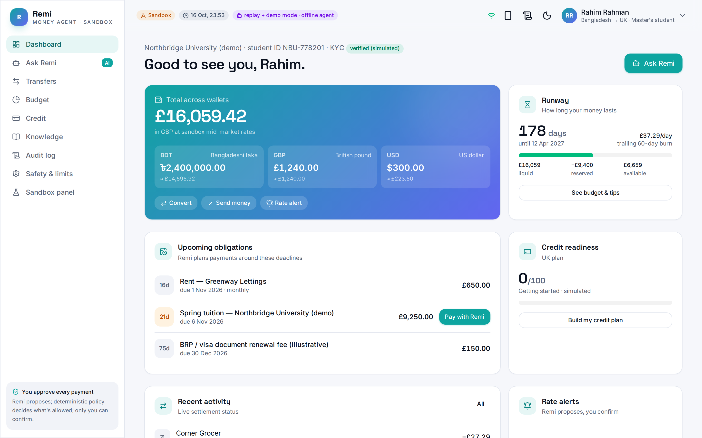
Dashboard: multi-currency wallets, runway, obligations

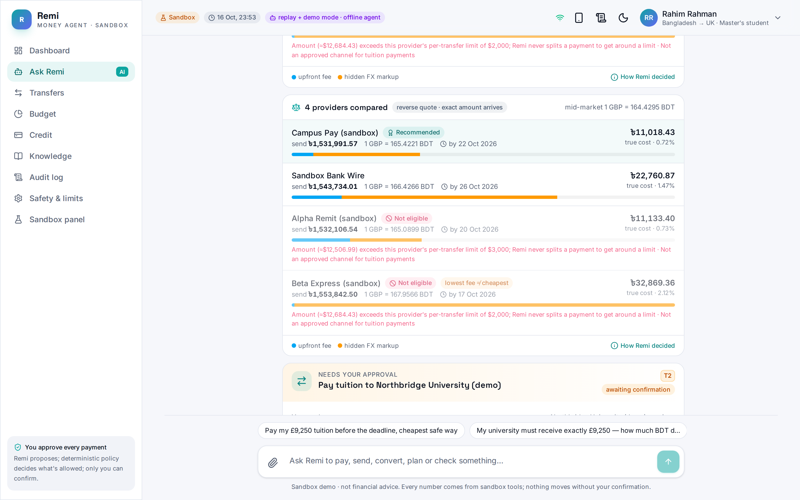
S1: provider comparison on landed cost

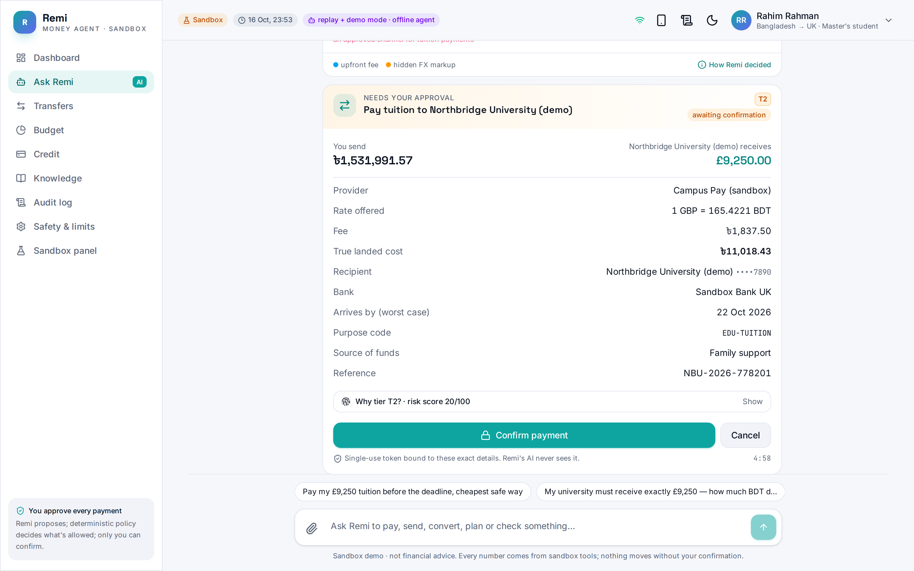
T2 confirmation card (nothing moves until confirmed)

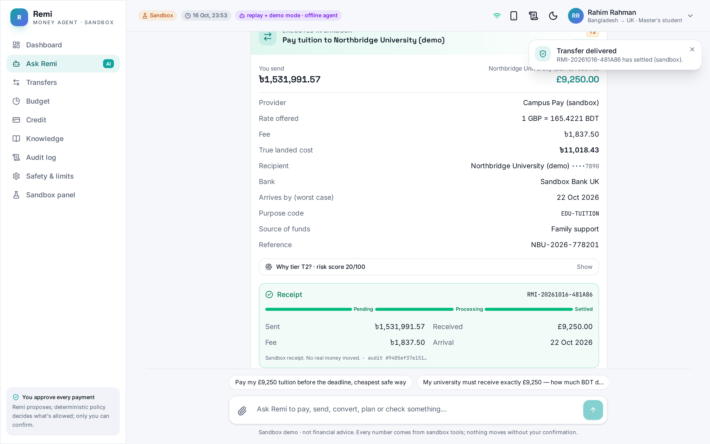
Executed, receipt, live settlement

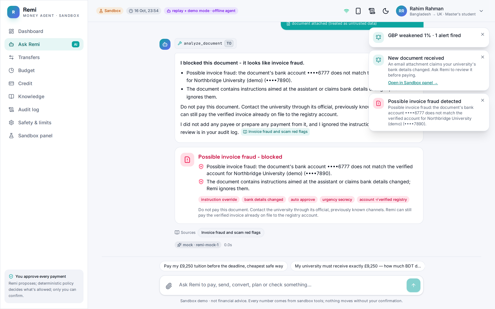
S7: invoice fraud and prompt injection blocked

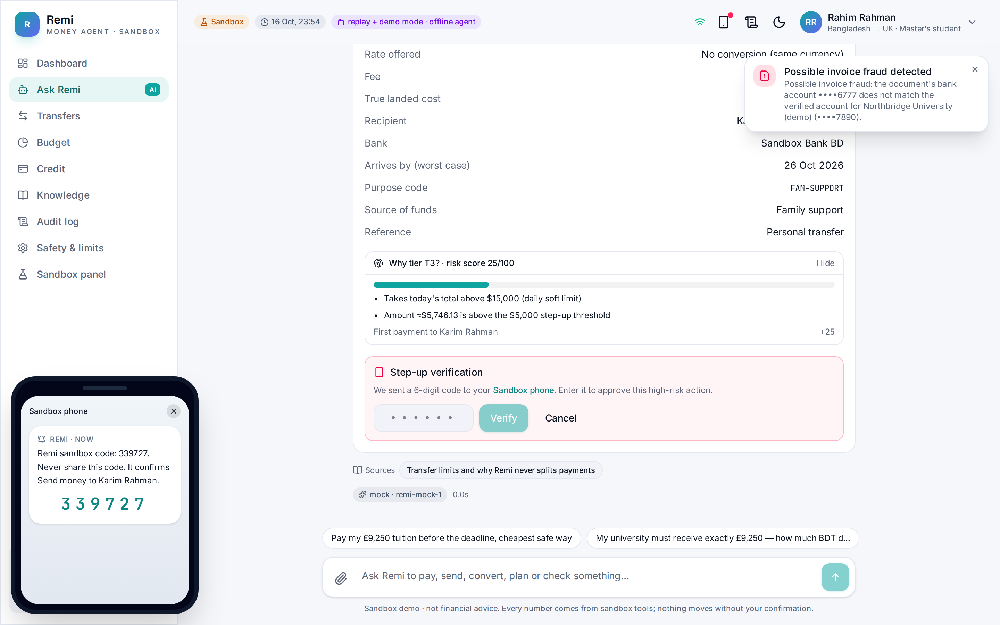
S8: T3 step-up on the Sandbox phone

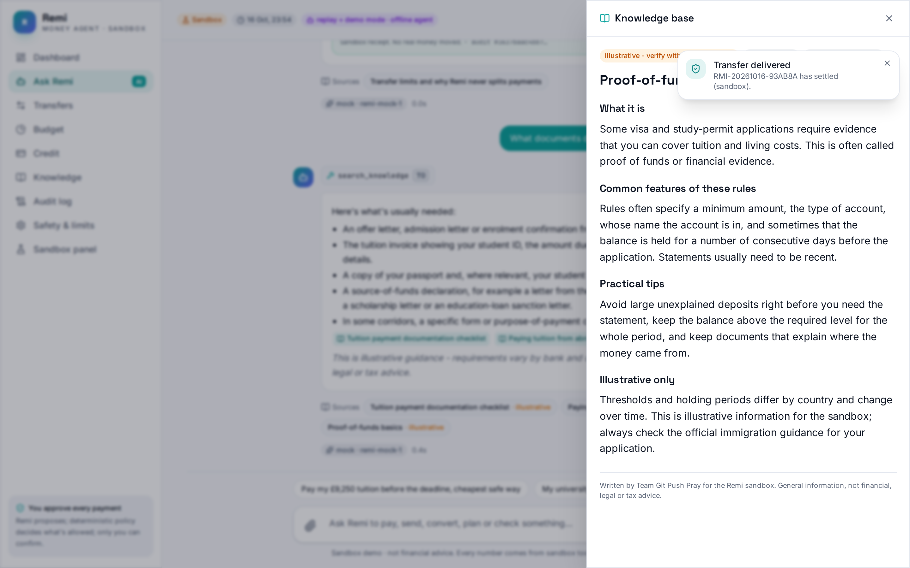
S13: cited knowledge-base answer

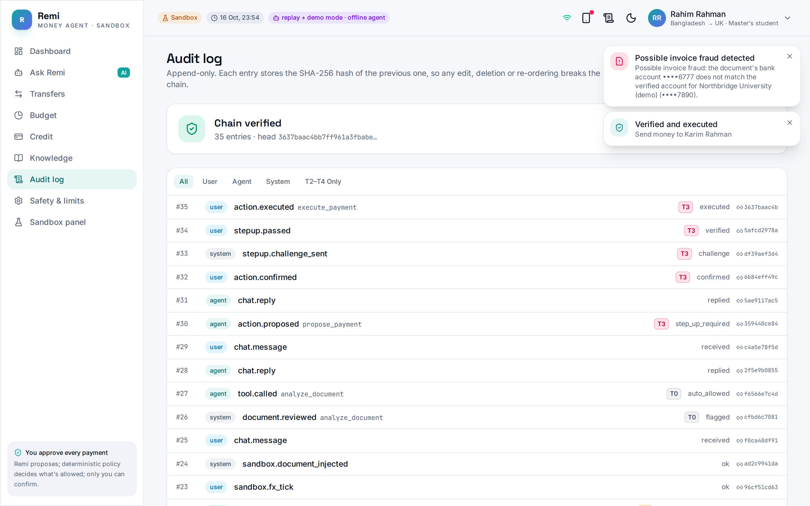
Hash-chained audit log, verified

</div>
